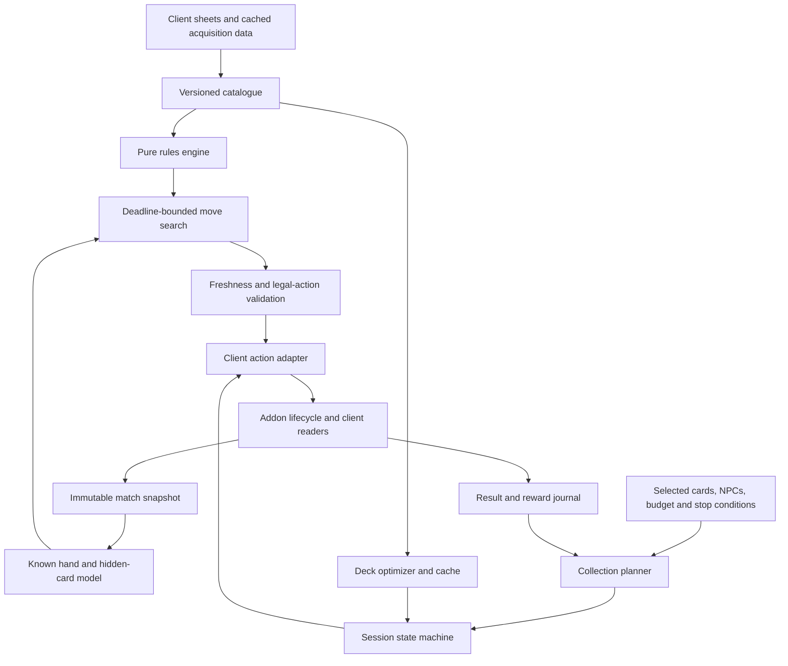

# FFXIV Triple Triad: research and automation design

Research date: **19 October 2026**. Scope: current public card data, game rules, strategy, source-level review of public Dalamud projects, and a proposed implementation. No plugin was installed into FFXIV, and no live game session was used.

**Recommendation:** build an NPC-focused automation system around an independently testable rules engine and an explicit session controller. Evaluate AutoTripleTriadGrind first if adopting its AGPL licensing is acceptable; it already covers most of the requested end-to-end workflow. For a permissively licensed implementation, use the MIT TriadBuddy lineage and BSD-licensed Saucy as the starting points. Spend the first development effort on rule conformance, state freshness, and measured solver quality. Starting with another solver from scratch would duplicate substantial existing work.

This recommendation follows source inspection, not an in-game comparison. In particular, **“existing automation,” “optimal play,” and “reliable unattended operation” are three different claims**. This research supports the first, identifies gaps in the second, and does not establish the third.

The resource bundle includes a [searchable card catalogue](CARD_CATALOGUE.html), [475-card CSV](data/cards.csv), [NPC list](data/npcs.csv), [NPC fixed/variable deck pools](data/npc-decks.csv), [example decks](data/example-decks.json), [100 public deck samples](data/community-decks-sample.csv), raw API snapshots, pinned source checkouts, and reproducible validation outputs.

## Findings that change the implementation decision

1. **A dedicated collection bot already exists.** AutoTripleTriadGrind has collection planning, NPC assignment, travel, deck construction, match play, registration, and continuation. Its existence changes the first question from “how do we build everything?” to “which existing implementation meets our licensing and reliability requirements?” [Project overview][attg-readme]
2. **Current Saucy is substantially self-contained.** Its TripleTriad directory contains game logic and automation, rather than merely forwarding moves from an installed TriadBuddy plugin. It also has collection UI, cache management, travel integrations, and reward tracking. [Saucy source tree][saucy-tree]
3. **The inspected solvers are not proofs of optimal play.** Their search mixes exploration with random rollouts; the inherited result ranking is discontinuous. Their displayed probabilities need empirical calibration. [Saucy agents][saucy-agents], [result scoring][saucy-solver]
4. **A real rules discrepancy is reproducible offline.** AutoTripleTriadGrind terminates repeated synthetic draws after three restarts; its upstream tests still all pass. Saucy contains the same cap. The official guide describes five additional drawn games. [Flow rules][attg-flow], [Saucy modifiers][saucy-mods], [official guide][official]
5. **Data collection is tractable; full collection automation is a larger problem.** The snapshot has 475 cards, but only 244 occur in the gathered NPC reward lists. The remaining acquisition paths include duties, achievements, currencies, packs, and tournaments. An NPC match bot cannot by itself obtain the complete collection. [Card API][collect-cards], [NPC API][collect-npcs]

## Evidence and freshness

Three labels apply throughout:

- **Verified:** fetched data, inspected source behavior, or a reproduced offline result.
- **Source claim:** an upstream project describes a feature that was not exercised in the game.
- **Design recommendation:** the proposed architecture, algorithms, and acceptance criteria below.

The public snapshots were retrieved on the research date. FFXIV Collect labels its newest gathered cards **7.51**. XIVAPI returned game-data version `5c744a8d8daafb25`, with schema `exdschema@2:rev:e773c41a90aed788cf4c1c48469fa85618ef01fb`. Those identifiers describe the fetched dataset; they do not prove compatibility with a particular installed client or regional release. The [source manifest](data/source-manifest.json) records URLs, local write times, byte counts, and SHA-256 hashes.

The card and NPC APIs are maintained community data sources. The game sheets exposed by XIVAPI provide an independent comparison for numerical card attributes. **All four side values matched for all 475 collected cards.** That check does not validate every acquisition condition or drop rate. [XIVAPI sheet access][xivapi-sheets], [validation summary](data/summary.json)

The official guide itself still includes an explicitly historical “80 cards” statement for patch 2.51. Older guides also retain obsolete collection-size deck restrictions. Dates and patch context matter even when the host is authoritative. [Official guide][official], [patch 5.4 changes][patch54]

## Card list and data model

### Snapshot coverage

| Dataset | Observed coverage | Interpretation |
|---|---:|---|
| FFXIV Collect cards | 475 | Complete response from this endpoint on the research date |
| Rarity 1 / 2 / 3 / 4 / 5 | 53 / 99 / 171 / 83 / 69 | Computed from those card records |
| Normal / Society / Scion / Primal / Garlean | 359 / 36 / 22 / 30 / 28 | “Normal” means no typed-card affiliation |
| FFXIV Collect NPC records | 134 | Locations, prerequisite quests, rules, rewards |
| Distinct cards in those NPC reward lists | 244 | Includes alternative sources; not a promise all NPCs are currently accessible |
| XIVAPI TripleTriad rows | 146 | Includes two empty rows |
| Nonempty NPC deck rows | 144 | Includes rows absent from the collection site's named NPC list |
| Pack definitions | 7 | Contents and listed purchase costs, where present |
| Community deck sample | 100 | Deliberately limited sample, not the site's complete deck database |

Counts are calculated from the saved [card](data/collect-cards.raw.json), [NPC](data/collect-npcs.raw.json), [pack](data/collect-packs.raw.json), and [sheet](data/xivapi-npc-decks.raw.json) responses. The endpoints are linked in the manifest. **A sheet row is not evidence of a reachable NPC.** Do not advertise 144 playable opponents on the strength of this export alone.

Each normalized card record has its card ID, album number, name, stars, type, four named directions, patch, duplicate-sale MGP, acquisition text, NPC source IDs, and source URL. Store values as **top, right, bottom, left**, with numeric `10` for A. Avoid copying the visual ordering of an HTML table: it can differ from clockwise order.

Preserve these identities separately:

| Identity | Why it must remain distinct |
|---|---|
| TripleTriadCard row ID | Stable join between card names and numerical data |
| Album number / EX number | Presentation identifier; not interchangeable with row ID |
| Inventory item ID | Required to recognize and register an awarded card item |
| TripleTriad NPC row ID | Fixed cards, variable pool, fee, and rule references |
| ENpcResident / ENpcBase identifiers | Names, world objects, and location matching |
| TripleTriadResident identifier | Defeat/achievement tracking uses a different namespace |
| Hand slot / card instance | Two identical card identities can occur after match transformations |

For example, Tiisol Ja has card ID **475**, but album number **No. 460**. The collection API's NPC `resident_id` should not be passed blindly to the separate defeated-NPC function. [Card record][tiisol], [UIState declarations][struct-uistate]

**Recommended runtime source hierarchy:** use the installed client's Lumina sheets for card sides, types, rule IDs, and NPC deck pools; use game state for ownership and current match rules; use cached collection metadata for acquisition explanations and planning. Keep an offline snapshot for reproducibility. Never require a web request to select a move.

TriadBuddy's loader demonstrates joins across card, NPC, item, rule, and map data. Its rule mapping is especially significant: old solver enum values differ from game-sheet IDs. For example, Same is sheet ID 4 but solver index 7. Map explicitly, or adopt the sheet IDs throughout a new engine. [TriadBuddy loader][buddy-loader]

The current sheet has **15 named advanced rules plus the empty/None entry**. A code constant of 16 includes None; it is not evidence of sixteen distinct advanced mechanics. [Rule snapshot](data/xivapi-rules.raw.json), [AutoTripleTriadGrind enum][attg-ruleids]

## Rules and constraints

### Deck legality

A standard player deck has five distinct registered cards. At most one may be five-star, and at most two may be four-star or higher. Thus `5★ + 4★ + three ≤3★` and `4★ + 4★ + three ≤3★` are legal. High-rarity slots need not be filled. NPC pools must not be filtered through player deck restrictions. [Official rarity limits][official], [deck validation implementation][attg-deck]

Patch 5.4 removed collection-size restrictions on one-, two-, and three-star cards. Do not implement the old 30/60-card unlock thresholds. The same patch introduced the present 90-second deliberation budget with a separate, non-carrying five-second grace window per turn. The game can place a card automatically after timeout, which is also a state-synchronization concern for a plugin. [Patch 5.4][patch54]

Validate a **saved deck** separately from the **current hand**. Random, Swap, Draft, and Sudden Death can invalidate assumptions about ownership, identity, or composition that were true at registration. Deck validation should return structured reasons, not merely a Boolean.

The official UI guide describes five preset slots; both inspected TriadBuddy and Saucy readers expose indices 0–4. FFXIVClientStructs has storage for ten deck records. Treat storage capacity and supported UI slots separately; verify the writable slot range against the actual client. [Profile reader][saucy-profile], [GoldSaucerModule][struct-gs]

### Board mechanics

The board is 3×3. Players alternate placements into empty cells. Compare touching edges; ordinary capture requires a strictly stronger value, so ties do not flip. Cards have fixed orientations. End scoring includes the unplayed tenth card: a board-only tally can report the wrong winner. Normal captures do not themselves create unlimited chains. Combo propagation is associated with the special capture rules. [Simulation implementation][attg-simulation], [capture rules][attg-capture]

The following is a compact mechanics map. The last column gives proposed implementation handling, not evidence that every upstream project handles it fully.

| Rule | Effect | Required handling |
|---|---|---|
| All Open | Both hands visible | Exact known-hand state |
| Three Open | Three cards per hand exposed | Track visibility by slot |
| Same | At least two touching values match | Evaluate friendly and enemy participants |
| Plus | At least two touching sums match | Group equal sums before mutation |
| Sudden Death | Draws restart using controlled cards | Carry hands, round count, and remaining card |
| Random | Chosen deck replaced from collection | Read actual dealt hand |
| Order | Cards must follow deck order | Ordered deck optimization |
| Chaos | Game selects the playable card | Honor forced slot |
| Reverse | Lower values capture higher ones | Rule-aware comparison |
| Fallen Ace | 1 beats A; interaction reverses under Reverse | Explicit exceptional comparison |
| Ascension | Typed cards gain shared type bonuses | Preserve raw and effective values |
| Descension | Typed cards receive shared type penalties | Apply floor and ordering correctly |
| Swap | One card exchanged before play | Reconcile actual hand instances |
| Draft | Cards selected from supplied offers | Separate draft-selection controller |
| Roulette | Rules resolved randomly | Observe resolved rules before solving |

Mechanics are represented in the inspected [capture rules][attg-capture], [flow rules][attg-flow], and [type rules][attg-type]. These implementations are useful specifications to test, not substitutes for client observations.

For Same and Plus, one friendly neighbor can participate in the matching condition while an enemy is captured. Only newly captured enemy cards seed the relevant Combo worklist. Build that worklist from a consistent view of the placement, then apply cascades with an explicit visited/ownership policy. Test normal and special captures occurring on the same placement.

Type shifts deserve special attention. Saucy separates the preexisting type modifier used during placement from the increment applied after captures. A new implementation that increments first can disagree with this behavior. Confirm event ordering using a targeted client fixture. Keep unclamped type counts separately from displayed values; applying another modifier to an already clamped value can produce errors. [Saucy type-shift implementation][saucy-mods]

Regional and NPC rules can combine. Rules may differ from a cached preview, and some NPCs ignore regional rules. Read the active preparation/board state every match and rebuild the simulation when it changes. Do not infer the current combination solely from a static NPC database. [Regional-rule reconstruction][saucy-region]

Sudden Death's official description allows five additional drawn games. The reviewed implementations stop their simulation earlier; this needs an explicit compatibility decision, not an undocumented search shortcut. [Official description][official], [reproduction](validation/rule-probe-output.txt)

### Tournaments and other modes

Ordinary NPC collection matches are the best-supported automation target. Open/Invitational events introduce a draft phase and tournament-wide state. Patch 5.4 describes three sets of offered cards and three-match competitions; tournament participation is consequently more than pressing the normal challenge button. [Tournament introduction][patch54]

TriadBuddy explicitly limits its solver to NPC matches because it relies on known NPC card pools. Removing its PvP guard does not supply a model for an arbitrary human opponent's hand. Draft NPCs and human competitors also require different knowledge assumptions from ordinary fixed-pool NPCs. [TriadBuddy scope][buddy-readme]

Battlehall travel and ordinary NPC interaction are distinct from solving PvP matches there. If tournament support is added, it needs its own mode detector, draft optimizer, opponent model, scoring objective, queue handling, and completion tests. It should remain marked unsupported until those paths have been validated.

## Deck building and strategy

### Practical deck seeds

These are **legal illustrative starting points**, checked against the gathered card data. They are not measured best decks, and ownership remains a requirement. Each can be inspected in [example-decks.json](data/example-decks.json).

| Purpose | Five cards | Why this is a useful seed |
|---|---|---|
| Tutorial baseline | Dodo, Sabotender, Bomb, Mandragora, Coeurl | The initial collection provides a reproducible starting benchmark |
| Ordinary corner play | Squall Leonhart, Senor Sabotender, Estinien, Lucia goe Junius, Hilda | Distinct double-eight orientations, a four-star, and a double-A card |
| Ascension, Primals | Ifrit, Titan, Garuda, Ramuh, Shiva | All typed alike; legal two-four-star composition |
| Ascension, Scions | Thancred, Y'shtola, Urianger, Heavensward Thancred, Heavensward Y'shtola | Shared type with varied edge coverage |
| Budget Reverse | Tonberry, Spriggan, Bomb, Mandragora, Gaelicat | Low sides provide candidates under Reverse; high sides require protection |

Card names, rarities, affiliations, and directional values come from the saved [catalogue](data/cards.csv), numerically cross-checked against XIVAPI. Selection and tactical interpretation are this report's analysis. Senor Sabotender costs 200,000 MGP in the gathered source, so the ordinary-corner seed is not presented as an inexpensive beginner shopping list. [Senor Sabotender][senor]

Under ordinary rules, adjacent strong sides can face the board interior while weak sides face the edge. For example, Estinien's top/right 8s fit a lower-left defensive placement; Lucia's top/left 8s fit lower-right; Hilda's bottom/left 8s fit upper-right. Squall's right/bottom As fit upper-left. That describes favorable orientations, not a fixed script: captures, move order, and special rules can make another placement better.

Additional strategic conclusions from the rules:

- **Play for the terminal result.** Taking two cards now may expose a larger recapture. An apparently quiet move can deny the opponent its last favorable square.
- **Ordinary ties can protect cards.** A strong equal edge blocks basic capture, but Same/Plus can bypass that intuition.
- **Same/Plus change the value of weak cards.** Evaluate matching patterns and future combo access; a ranking based only on total side strength discards useful cards.
- **Reverse changes both offense and defense.** Low values become strong; preserve the Fallen Ace interaction instead of simply negating every heuristic.
- **Ascension helps both owners of a type.** Shared affiliation can improve the opposing hand too. Descension can favor untyped cards under ordinary comparison, while Reverse changes that conclusion.
- **Order makes sequencing part of the deck.** The same five cards have up to 120 permutations; caching by a sorted card set loses information.
- **Swap requires resilience.** A strategy dependent on retaining a single ace may have weak expected performance after exchange.
- **Do not assume the NPC always plays greedily.** That is an opponent model to measure, not a game rule.

### Optimizer recommendation

Optimize per **owned collection × opponent pool × active rules × goal**, rather than publishing a single universal deck. Use heuristics to create a manageable candidate pool, search legal compositions, simulate both starting-player cases, then reevaluate finalists with independent seeds and the actual live policy.

Candidate filters should retain diversity by direction, type, rarity, and special-rule utility. Strict numerical dominance pruning is unsafe under Same, Plus, Reverse, and Fallen Ace. Even equivalent stat vectors may have different ownership, affiliation, or acquisition implications. Saucy already has typed-card pool scoring and parallel deck enumeration; these are useful starting points but do not establish a globally optimal deck. [Pool selection][saucy-pool], [deck search][saucy-search]

A generated candidate should carry its score estimate, sample count, rules fingerprint, opponent pool fingerprint, solver version, ownership fingerprint, and evaluation date. Reevaluate when any of those assumptions changes. Use public deck votes and guide recommendations as candidate seeds, never as measured win probabilities. The downloaded [community deck sample](data/community-decks-sample.csv) preserves identifiers and legality checks without treating ratings as performance evidence.

## Public repository audit

The [repository manifest](data/repository-manifest.json) contains full hashes and commit timestamps. All linked source findings below use pinned revisions. Default-branch code is not necessarily identical to the latest distributed binary.

| Project | Inspected revision | License / build snapshot | Best use |
|---|---|---|---|
| MgAl2O4/FFTriadBuddyDalamud | `1bffa57921d3` | MIT; Dalamud SDK 15.0.0 | Small NPC assistant, data loader, readers, optimization UI |
| MgAl2O4/FFTriadBuddy | `425f72ecb3ba` | MIT; standalone snapshot updated for 7.25 | Solver ancestry, simulation and screenshot tooling |
| PunishXIV/Saucy | `53971e8b75f2` | BSD-3-Clause root; SDK 15.0.0; version 2.1.2.5 | Permissive automation and modern integration reference |
| XeldarAlz/FFXIV-AutoTripleTriadGrind | `71da7486806c` | AGPL-3.0-or-later; SDK 15.0.0; version 1.2.1.0 | Closest complete NPC collection workflow |
| curtissvoboda/FFTriadBuddyEnhanced | `4644dbe7ccf3` | MIT file; SDK 13.0.0 | Cautionary comparison for solver claims |
| aers/FFXIVClientStructs | `d15a6e4a2dff` | MIT | Native structures and typed interop definitions |
| fae-industries/ffxiv-collect | `f4a9c97bff06` | Data application source inspected | API semantics and acquisition metadata |

The Dalamud plugin's `triad-shared` submodule is pinned to **`85c2c4476a30f316bfb1ba5c0343cba5b584e371`**, which is distinct from the separately cloned standalone HEAD. Preserve the actual submodule revision when reproducing plugin behavior. [Submodule definition][buddy-submodule]

### TriadBuddy

The plugin provides NPC move suggestions, pre-match deck evaluation, deck optimization, and collection assistance. Its own README rules out general PvP solving. The loader obtains live client sheet data, so the standalone repository's older XML snapshot is not the right card database for a new plugin. [Plugin overview][buddy-readme], [loader][buddy-loader]

Useful integration boundaries are `UIReaderTriadGame`, `UIReaderTriadPrep`, `UIReaderTriadResults`, `GameUIParser`, `SolverGame`, and the unsafe collection/profile readers. `SolverGame.UpdateGameRunSolver` calls the solver synchronously and returns `Task.FromResult`; the async-looking caller does not make the expensive work asynchronous. A rewrite should explicitly move pure computation off the framework thread. [SolverGame][buddy-solvergame]

### Saucy

Its Triple Triad flow distinguishes preparation, deck selection, board turns, results, and rematches. Separate components track goals, ownership, rewards, registration, and nearby NPC validity. The deck cache includes ownership-at-build information and regional signatures. Travel integrations include Lifestream and vnavmesh. [Automator][saucy-automator], [cache structures][saucy-cache], [navigation tree][saucy-navigation]

`TriadBoardAutomation` reads a fresh board, checks turn readiness, obtains a move, and submits a native addon callback. It also updates the addon and writes its turn-state field. This is version-sensitive client behavior, not a stable Dalamud gameplay API. The local reward-agent structure uses an explicit field offset. Treat such operations as isolated adapters with their own compatibility checks. [Board automation][saucy-board], [local structures][saucy-local]

The live move path still calls `FindNextMove` synchronously. It suspends background deck work while a match is active. The live agent is `CarloTheExplorer`; the search explores smaller action spaces and uses random rollouts for larger ones. Opponent layers aggregate outcomes rather than implementing a general adversarial minimax policy. Describe its output as an estimate under a model. [Live move path][saucy-move], [agents][saucy-agents]

### AutoTripleTriadGrind

This is the most directly relevant complete-product reference. `CollectPlanner` assigns desired cards to eligible NPCs, preferring reward overlap, then orders visits by zone and proximity. It is a useful greedy heuristic; it does not optimize expected farming time using measured drop rates. [Collection planner][attg-planner]

`AutoCommon.TriadMatch` handles challenge, deck selection, board play, result reading, and rematches. Unlike Saucy's inspected live path, it copies a board snapshot and solves through `Task.Run`. It has explicit timeouts and an unreadable-board fallback. It checks turn readiness when a result returns, but the inspected commit path does not compare a full snapshot fingerprint before placing the returned move. That creates a stale-result risk to test; it is not an observed live failure. [Match controller][attg-match]

Its pure logic test project can run without the game. **All 18 upstream tests passed** under .NET 10.0.102. They cover basic captures, several rules, an initial Sudden Death restart, solver behavior, and optimizer behavior. They do not establish complete rule-combination coverage, full restart limits, live callback correctness, travel reliability, or card-drop accuracy. [Simulation tests][attg-tests], [solver tests][attg-solvertests], [saved results](validation/upstream-tests.trx)

The third-party notices explicitly identify portions adapted from Puni.sh and MgAl2O4. Accordingly, agreement between these solvers is not fully independent evidence: related implementations can carry the same mistake. [Third-party notices][attg-notices]

### FFTriadBuddyEnhanced

The README claims broad PvP support and sophisticated learning. Inspection gives insufficient grounds to recommend it: `SimulateGame` creates hypothetical cards with independently random side values rather than sampling valid remaining hands. Such rollouts can explore cards and combinations that are not in the legal opponent model. The project also targets an older SDK snapshot. No build or gameplay verification was performed for this fork. Its claims should not be used as evidence that the PvP problem is solved. [PvP implementation][enhanced-solver], [project file][enhanced-project]

### Licensing and distribution constraints

The MIT and BSD sources provide a permissive starting point subject to their notices and conditions; preserve inherited notices and audit dependencies. AutoTripleTriadGrind declares AGPL-3.0-or-later and has additional notice/trademark documents. Choose that path deliberately before copying its implementation. A rewritten file layout does not erase provenance. These are repository observations, not a legal compatibility opinion. [MIT license][buddy-license], [Saucy license][saucy-license], [AutoTripleTriadGrind licensing][attg-license]

There is also a distribution constraint independent of source licensing: Dalamud's official repository guidelines restrict automated server interactions and competitive advantages. A fully automated gameplay plugin should not be planned around acceptance into the official repository. A custom repository changes distribution, not Square Enix's rules. Square Enix prohibits third-party tools and identifies automation as botting, with account penalties possible. [Dalamud restrictions][dalamud-restrictions], [Square Enix policy][se-tools]

## Reproduced gaps and priorities

| Finding | Evidence level | Recommended response |
|---|---|---|
| Sudden Death stops after three restarts | Source in two projects; reproduced in AutoTripleTriadGrind | Model official round limit separately from a search horizon; validate on current client |
| Result score can rank lower win chance higher | Source and numeric probe | Replace opaque category ranking with an explicit goal utility |
| Opponent policy is approximate | Source | Compare random, greedy, robust, and empirically fitted policies |
| Live solve may occupy the framework thread | Source in inspected Saucy/TriadBuddy paths | Snapshot on framework thread; compute on worker with deadline |
| Background move freshness check is incomplete | Source-based risk in inspected AutoTripleTriadGrind path | Match/round/turn generation plus fingerprint validation |
| Native offsets and callbacks can drift | Source-level dependency | Centralize adapters; reject unknown layouts |
| Draft rule object exists without demonstrated draft automation | Source scope distinction | Track selection phase and tournament lifecycle separately |
| Card identity inferred from displayed attributes can be ambiguous | Structural limitation | Match candidate sets with hand history, type, rarity, and known pools |

The [offline probe](validation/RuleProbe/Program.cs) forced consecutive draws using synthetic equal-sided cards. The unmodified referenced engine played **36 placements, three restarts, then BlueDraw**. The fixture deliberately uses synthetic repeated cards to isolate the rule; it is not a legal saved player deck and does not claim to reproduce an actual NPC encounter.

The same probe compared outcome estimates A = 40% win / 35% draw / 25% loss and B = 45% win / 50% draw / 5% loss. The inherited score gives A **10.4**, B **0.5**, and prefers A. B is better for both win probability and loss avoidance. This is a concrete reason to change the objective before attempting more search depth. [Scoring implementation][attg-solver], [probe output](validation/rule-probe-output.txt)

The inspected board structure exposes sides, rarity, type, owner, and occupancy, but does not identify its unknown bytes as a card ID. Do not reinterpret those bytes as IDs without evidence. A solver can often use an equivalence class of cards; collection accounting must resolve an actual identity. [AddonTripleTriad structure][struct-addon]

## Proposed architecture

This section is the recommended design, not a description of a plugin implemented during this research.

### Components and contracts

| Component | Owns | Must not own |
|---|---|---|
| Catalogue | Card definitions, NPC pools, source joins, version IDs | Live pointers or UI actions |
| Rules engine | Legal actions, captures, transforms, scoring, round transitions | Network access or Dalamud services |
| Observation adapter | Addon lifecycle, raw reads, validation, canonical snapshots | Strategic choices |
| Belief model | Hidden-hand candidates and observation history | Fictional certainty about hidden slots |
| Solver | Move selection within deadline, estimates, diagnostics | Client interaction |
| Deck optimizer | Candidate generation and independent evaluation | Blocking the render/framework loop |
| Session controller | Challenge/play/result/register/rematch lifecycle | Rule arithmetic duplicated from engine |
| Collection planner | Reachable goals, ordering, budgets, replanning | Assuming every database NPC is unlocked |
| Action adapter | Validated, versioned game interactions | Unchecked retries or stale actions |
| Journal | Outcome/reward accounting and recovery state | Treating a click as an acknowledged result |

In C#, keep the core library independent of Dalamud so deterministic fixtures and benchmarks run in CI. Use immutable or exclusively owned snapshots. No native pointer, addon node reference, or mutable shared rule object may cross into the worker solver. Rule instances with match state need deep copies per worker; the existing projects already recognize this need. [Worker-copy implementation][attg-solver]

A match snapshot should include session ID, match generation, round number, turn generation, observed opponent identity, current mode, effective rules, board occupancy/owners, known card attributes, player hand slots, forced card slot, remaining counts, type modifiers, observed timer, and confidence/error fields. Preserve observation history separately from current display state.

A solver result should include its input fingerprint, selected hand slot and board cell, estimated win/draw/loss, sampled hypotheses, work count, elapsed time, and termination reason. Before committing, reread the current state and check fingerprint, legal slot, empty cell, forced-card constraint, and turn readiness. If the result is stale, discard it and solve again.

### Session lifecycle

Use explicit states: `Idle → ResolveGoal → Travel → AwaitNPC → Challenge → ReadPreparation → SelectDeck → AwaitBoard → ObserveTurn → Solve → ValidateAndPlace → AwaitTransition → ReadResult → ReconcileReward → RegisterCard → ReplanOrRematch → Completed`.

Every state needs a deadline, bounded retries, an expected observation, and a recoverable exit. An action is complete only when its expected state change appears. Store an action-generation identifier so a frame callback cannot submit the same turn twice. Distinguish “finish this match then stop” from immediate cancel.

For a local-NPC first release, keep travel optional. For collection routing, use a narrow movement IPC contract with explicit start, progress, arrival, cancellation, and failure results. Unknown entrances, locked zones, incomplete quests, and unavailable NPCs should produce a visible blocked reason and allow another reachable goal. Map coordinates are not sufficient world-navigation coordinates; world positions and territory transitions need their own validated data.

Registration is a separate transaction: record the awarded item, wait for inventory state, use the card if unregistered, then confirm the ownership bit. Do not mark acquisition complete merely because the result screen was closed. Inventory-full and duplicate cases need independent handling. Reward totals must be idempotent across repeated scans and reconnect recovery.

Preserve the user's chosen deck slot before writing an optimized deck. Restore it when the session ends if restoration is enabled and the user has not independently changed it. Store this backup outside the volatile session. Automation should never silently consume all deck slots.

### Runtime integration

Prefer typed FFXIVClientStructs wrappers and Dalamud lifecycle/framework services where available. UI actions and native reads remain framework-thread work. Put version-specific callback details, offsets, signatures, and addon schemas into one compatibility layer. Detect unsupported layouts early and stop issuing dependent actions.

Do not make fixed frame counts the sole acknowledgement mechanism. Frame rate, animation timing, and latency vary. Poll a validated state predicate or consume a lifecycle event, with a monotonic time deadline. Log the relevant snapshot when parsing fails so the issue can be reproduced offline.

Use stable game IDs for internal identity and localization only for display. Where UI text must be parsed, retain language-specific test cases and a conservative unknown outcome. Configuration and reward logs should be scoped to the current character; switching characters invalidates ownership-dependent caches.

## Solver design: reliable before more elaborate

### Search model

For a fully known position, use iterative deepening and an exact endgame search with transposition caching. A robust adversarial policy is minimax/alpha-beta; an NPC exploitation policy uses an explicit model of the NPC's actions. Those solve different objectives and should be selectable and benchmarked separately.

Do not assume that a nine-cell board makes an opening full-width search cheap. With two known five-card hands and no forced order, a simple upper count is `9! × 5! × 5! = 5,225,472,000` placement sequences before considering pruning. This is a combinatorial calculation, not a measured runtime. Exact search is much more attractive late in the match.

For hidden NPC cards, derive a constrained belief over fixed cards, variable pool selections, exposed slots, and cards already played. Remove impossible hands as observations arrive. Sample **complete consistent hands without replacement**, not independently generated card values or every variable card simultaneously. An NPC with a fixed core and optional pool still has five cards in a match.

Use expectimax for explicit random events when feasible. For larger hidden-state trees, information-set Monte Carlo search is a candidate; benchmark it against a simpler belief-sampling baseline before adopting it. Be careful with determinization: choosing a different future policy for each hidden hand can overestimate what a player who has not seen the hand can achieve. Chance variables, hidden information, and opponent choice must remain separate concepts. Cowling, Powley, and Whitehouse's original ISMCTS paper explains this strategy-fusion problem and information-set search; it is a methodological resource, not a Triple Triad benchmark. [Original research paper][ismcts]

A transposition key needs the board, ownership, hand instances, remaining pool constraints, side to move, forced slot, effective rules, type counts, and Sudden Death round state. Symmetry reductions must transform card directions consistently; rotating only the board is invalid. Disable a reduction whenever its invariants are not proven for the active rules.

### Objective and performance budget

Choose a transparent objective such as `U = P(win) + drawWeight × P(draw)`. For NPC card farming, evaluate verified target drops per elapsed time; for MGP, evaluate expected net reward after fees per elapsed time. The weight is a product choice and should be visible in diagnostics.

For a target with per-win drop chance `q`, win chance `p`, and average cycle time `t`, a simple independent-trial model gives expected time approximately `t / (p × q)`. This is an explanatory model, not a claim that any particular drop has a known rate. Sudden Death, variable durations, multiple rewards, inventory handling, and travel require an expanded model. Do not infer drop rates from collection-site ownership percentages.

Proposed initial engineering budgets: produce a legal first candidate quickly; spend roughly 100–300 ms improving an ordinary move on the reference machine; permit an explicitly bounded extension when the measured timer allows it. These are targets to benchmark, not measured capabilities of the reviewed code. Cancel stale work and deprioritize deck optimization while a live move is pending.

If the parser is uncertain, the default should be to suspend automated action and show the reason. A fallback move policy may be useful, but only when hand/board legality is independently known; “play anything” should not hide a broken reader. Record fallback use separately from solver performance.

### Collection planning

Maintain selected goals, registered ownership, inventory-pending cards, reachable NPCs, fees, estimated match duration, and measured reward evidence. Assign goals to NPCs using expected remaining time and reward overlap, then account for travel. Replan after every newly registered card or reachability change.

A coverage-first heuristic, as in AutoTripleTriadGrind, is a sensible baseline. Improve it only when measurements justify the extra complexity. A short route to a low-win-rate opponent may be worse than a longer route to a fast reliable one. Keep unavailable duties, currencies, achievements, and event sources visible in the collection plan without pretending that the Triple Triad match controller can complete them.

## Validation and implementation sequence

| Phase | Deliverable | Completion condition |
|---|---|---|
| 1. Data and core | Versioned catalogue, standard legality, independent simulation | Cross-source validation and deterministic rule fixtures pass |
| 2. Observer | Read preparation, board, result, ownership | Recorded transitions agree with manual observations |
| 3. Adviser | Legal move recommendation with deadlines | No illegal suggestions; measurable performance against baselines |
| 4. Local match automation | One NPC, challenge to verified result | Bounded retries; stale moves rejected; emergency stop works |
| 5. Farming | Rematches, registration, stop conditions | Reward journal and ownership reconcile without double counting |
| 6. Deck optimization | Cache and per-opponent candidates | Beats or matches legal seed decks on held-out scenarios |
| 7. Collection routing | Multi-NPC plan with travel IPC | Unlock, travel failure, pause/resume, and zone transitions recover |
| 8. Additional modes | Draft/tournament controller if desired | Separate rule, draft, scoring, and lifecycle coverage |

The critical test corpus should cover:

- Ordinary captures, equal edges, boundaries, empty-cell rejection, and the tenth-card score.
- Same/Plus with a friendly participant, multiple matching groups, simultaneous normal captures, and multi-step Combo.
- Reverse × Fallen Ace, type shifts at both limits, and special capture interactions with type changes.
- Order and Chaos, including a changed forced slot while a solver is running.
- Random hand replacement, Swap with duplicate identities, and partial visibility after transformation.
- Sudden Death through the full official limit, ownership-based redistribution, leftover card handling, and repeated-round state reset.
- NPC fixed/variable pool accounting without impossible sixth-card hypotheses.
- Unreadable UI, callback rejection, frame-rate changes, automatic timer moves, reconnect, and character/territory changes.
- Full inventory, delayed registration, repeated reward observations, and stop-after-target acquisition.

Use fixed seeds for reproducibility and disjoint evaluation seeds for comparisons. Record win/draw/loss separately, with sample sizes and confidence intervals. Report live move latency percentiles, illegal-action count, parser disagreement count, fallback rate, repeated-action count, and reward reconciliation failures. Do not collapse all of these into a single “accuracy” value.

**Suggested acceptance priorities:** zero known illegal actions in the fixture corpus; no callback submitted from a stale snapshot; no unbounded retries; no silent unknown-rule handling; and verified ownership before a collection goal is marked complete. Numerical win-rate and throughput targets should be set after baseline measurements, rather than invented in advance.

For independent verification, compare simulated transitions with recorded client observations. Comparing only Saucy, TriadBuddy, and AutoTripleTriadGrind is insufficient because their implementation lineage overlaps.

## What is established, and what remains open

Established in this research: the public data snapshot, card-stat agreement, source architecture and licensing declarations, 18 passing upstream offline tests, the reproduced Sudden Death cap, and the counterexample to the score ranking. No public-repository popularity metric was used as proof of correctness.

Still requiring client evidence: callback behavior on the installed build, all rule-combination event ordering, late Sudden Death behavior, current NPC reachability/unlocks, hidden-card inference fidelity, NPC action probabilities, actual target drop rates, end-to-end navigation reliability, and comparative live win rate.

**Best implementation path:** adopt the closest complete workflow if its licensing and integration choices fit; otherwise retain the permissive engine/data foundations and implement a small, explicit controller around them. In either path, first separate simulation rules from search approximations, replace the inherited scoring discontinuity, and require fresh acknowledged state for every action. Those changes address demonstrated weaknesses before adding more automation scope.

## Source links

Inline citations link directly to the relevant documentation or pinned source file. The [API source manifest](data/source-manifest.json) and [repository manifest](data/repository-manifest.json) provide the complete downloaded-resource inventory. Useful entry points for further work are the [official rules][official], [FFXIV Collect card data][collect-cards], [XIVAPI sheet documentation][xivapi-sheets], [Saucy Triple Triad implementation][saucy-tree], and [AutoTripleTriadGrind overview][attg-readme].

[official]: https://na.finalfantasyxiv.com/lodestone/playguide/contentsguide/goldsaucer/tripletriad/
[ismcts]: https://eprints.whiterose.ac.uk/id/eprint/75048/1/CowlingPowleyWhitehouse2012.pdf
[patch54]: https://na.finalfantasyxiv.com/lodestone/topics/detail/44fc093d851594d701d09c855c13e05605af3f95
[collect-cards]: https://ffxivcollect.com/api/triad/cards
[collect-npcs]: https://ffxivcollect.com/api/triad/npcs
[tiisol]: https://ffxivcollect.com/triad/cards/475
[senor]: https://ffxivcollect.com/triad/cards/118
[xivapi-sheets]: https://v2.xivapi.com/docs/guides/sheets/
[dalamud-restrictions]: https://dalamud.dev/plugin-publishing/restrictions/
[se-tools]: https://na.finalfantasyxiv.com/lodestone/topics/detail/68f4c4d3bdea34f732ee8db3425122b8b8d6ec3b
[buddy-readme]: https://github.com/MgAl2O4/FFTriadBuddyDalamud/blob/1bffa57921d3eedbb201c227b6ea05f35a0ee75e/README.md
[buddy-loader]: https://github.com/MgAl2O4/FFTriadBuddyDalamud/blob/1bffa57921d3eedbb201c227b6ea05f35a0ee75e/data/GameDataLoader.cs
[buddy-solvergame]: https://github.com/MgAl2O4/FFTriadBuddyDalamud/blob/1bffa57921d3eedbb201c227b6ea05f35a0ee75e/plugin/SolverGame.cs
[buddy-submodule]: https://github.com/MgAl2O4/FFTriadBuddyDalamud/blob/1bffa57921d3eedbb201c227b6ea05f35a0ee75e/.gitmodules
[buddy-license]: https://github.com/MgAl2O4/FFTriadBuddyDalamud/blob/1bffa57921d3eedbb201c227b6ea05f35a0ee75e/LICENSE
[saucy-tree]: https://github.com/PunishXIV/Saucy/tree/53971e8b75f2f522e2f2201a1ebb55f9e9d4cc28/Saucy/TripleTriad
[saucy-agents]: https://github.com/PunishXIV/Saucy/blob/53971e8b75f2f522e2f2201a1ebb55f9e9d4cc28/Saucy/TripleTriad/GameLogic/TriadGameAgents.cs
[saucy-solver]: https://github.com/PunishXIV/Saucy/blob/53971e8b75f2f522e2f2201a1ebb55f9e9d4cc28/Saucy/TripleTriad/GameLogic/TriadGameSolver.cs
[saucy-mods]: https://github.com/PunishXIV/Saucy/blob/53971e8b75f2f522e2f2201a1ebb55f9e9d4cc28/Saucy/TripleTriad/GameLogic/Modifiers/TriadGameModifierRules.cs
[saucy-region]: https://github.com/PunishXIV/Saucy/blob/53971e8b75f2f522e2f2201a1ebb55f9e9d4cc28/Saucy/TripleTriad/GameLogic/TriadNpcSimulationRules.cs
[saucy-profile]: https://github.com/PunishXIV/Saucy/blob/53971e8b75f2f522e2f2201a1ebb55f9e9d4cc28/Saucy/TripleTriad/UI/Readers/TriadProfileDeckReader.cs
[saucy-pool]: https://github.com/PunishXIV/Saucy/blob/53971e8b75f2f522e2f2201a1ebb55f9e9d4cc28/Saucy/TripleTriad/GameLogic/TriadDeckOptimizer.Pool.cs
[saucy-search]: https://github.com/PunishXIV/Saucy/blob/53971e8b75f2f522e2f2201a1ebb55f9e9d4cc28/Saucy/TripleTriad/GameLogic/TriadDeckOptimizer.Search.cs
[saucy-automator]: https://github.com/PunishXIV/Saucy/blob/53971e8b75f2f522e2f2201a1ebb55f9e9d4cc28/Saucy/TripleTriad/Automation/TriadAutomator.cs
[saucy-cache]: https://github.com/PunishXIV/Saucy/blob/53971e8b75f2f522e2f2201a1ebb55f9e9d4cc28/Saucy/TripleTriad/GameLogic/DeckCache/TriadOptimizedDeckCacheEntry.cs
[saucy-navigation]: https://github.com/PunishXIV/Saucy/tree/53971e8b75f2f522e2f2201a1ebb55f9e9d4cc28/Saucy/TripleTriad/Collection/Navigation
[saucy-board]: https://github.com/PunishXIV/Saucy/blob/53971e8b75f2f522e2f2201a1ebb55f9e9d4cc28/Saucy/TripleTriad/Automation/TriadBoardAutomation.cs
[saucy-local]: https://github.com/PunishXIV/Saucy/blob/53971e8b75f2f522e2f2201a1ebb55f9e9d4cc28/Saucy/TripleTriad/UI/Readers/TriadLocalClientStructs.cs
[saucy-move]: https://github.com/PunishXIV/Saucy/blob/53971e8b75f2f522e2f2201a1ebb55f9e9d4cc28/Saucy/TripleTriad/UI/Session/Move/TriadSession.Move.cs
[saucy-license]: https://github.com/PunishXIV/Saucy/blob/53971e8b75f2f522e2f2201a1ebb55f9e9d4cc28/LICENCE.md
[attg-readme]: https://github.com/XeldarAlz/FFXIV-AutoTripleTriadGrind/blob/71da7486806c04aa00c7539cc68fad1f51d0add3/README.md
[attg-flow]: https://github.com/XeldarAlz/FFXIV-AutoTripleTriadGrind/blob/71da7486806c04aa00c7539cc68fad1f51d0add3/AutoTripleTriadGrind/Core/Triad/Logic/Rules/TriadFlowRules.cs
[attg-capture]: https://github.com/XeldarAlz/FFXIV-AutoTripleTriadGrind/blob/71da7486806c04aa00c7539cc68fad1f51d0add3/AutoTripleTriadGrind/Core/Triad/Logic/Rules/TriadCaptureRules.cs
[attg-type]: https://github.com/XeldarAlz/FFXIV-AutoTripleTriadGrind/blob/71da7486806c04aa00c7539cc68fad1f51d0add3/AutoTripleTriadGrind/Core/Triad/Logic/Rules/TriadTypeRules.cs
[attg-ruleids]: https://github.com/XeldarAlz/FFXIV-AutoTripleTriadGrind/blob/71da7486806c04aa00c7539cc68fad1f51d0add3/AutoTripleTriadGrind/Core/Triad/Data/TriadRuleId.cs
[attg-deck]: https://github.com/XeldarAlz/FFXIV-AutoTripleTriadGrind/blob/71da7486806c04aa00c7539cc68fad1f51d0add3/AutoTripleTriadGrind/Core/Triad/Logic/TriadDeck.cs
[attg-simulation]: https://github.com/XeldarAlz/FFXIV-AutoTripleTriadGrind/blob/71da7486806c04aa00c7539cc68fad1f51d0add3/AutoTripleTriadGrind/Core/Triad/Logic/TriadSimulation.cs
[attg-planner]: https://github.com/XeldarAlz/FFXIV-AutoTripleTriadGrind/blob/71da7486806c04aa00c7539cc68fad1f51d0add3/AutoTripleTriadGrind/Core/Planning/CollectPlanner.cs
[attg-match]: https://github.com/XeldarAlz/FFXIV-AutoTripleTriadGrind/blob/71da7486806c04aa00c7539cc68fad1f51d0add3/AutoTripleTriadGrind/Core/Tasks/AutoCommon.TriadMatch.cs
[attg-tests]: https://github.com/XeldarAlz/FFXIV-AutoTripleTriadGrind/blob/71da7486806c04aa00c7539cc68fad1f51d0add3/AutoTripleTriadGrind.Tests/SimulationTests.cs
[attg-solvertests]: https://github.com/XeldarAlz/FFXIV-AutoTripleTriadGrind/blob/71da7486806c04aa00c7539cc68fad1f51d0add3/AutoTripleTriadGrind.Tests/SolverTests.cs
[attg-solver]: https://github.com/XeldarAlz/FFXIV-AutoTripleTriadGrind/blob/71da7486806c04aa00c7539cc68fad1f51d0add3/AutoTripleTriadGrind/Core/Triad/Logic/TriadSolver.cs
[attg-notices]: https://github.com/XeldarAlz/FFXIV-AutoTripleTriadGrind/blob/71da7486806c04aa00c7539cc68fad1f51d0add3/THIRD-PARTY-NOTICES.md
[attg-license]: https://github.com/XeldarAlz/FFXIV-AutoTripleTriadGrind/blob/71da7486806c04aa00c7539cc68fad1f51d0add3/LICENSE.md
[enhanced-solver]: https://github.com/curtissvoboda/FFTriadBuddyEnhanced/blob/4644dbe7ccf3affc3e6f0a3fb737fcdb7c4f727d/plugin/SolverGame.cs
[enhanced-project]: https://github.com/curtissvoboda/FFTriadBuddyEnhanced/blob/4644dbe7ccf3affc3e6f0a3fb737fcdb7c4f727d/TriadBuddy.csproj
[struct-addon]: https://github.com/aers/FFXIVClientStructs/blob/d15a6e4a2dff32ce920e083ef18a034d4f445f58/FFXIVClientStructs/FFXIV/Client/UI/AddonTripleTriad.cs
[struct-uistate]: https://github.com/aers/FFXIVClientStructs/blob/d15a6e4a2dff32ce920e083ef18a034d4f445f58/FFXIVClientStructs/FFXIV/Client/Game/UI/UIState.cs
[struct-gs]: https://github.com/aers/FFXIVClientStructs/blob/d15a6e4a2dff32ce920e083ef18a034d4f445f58/FFXIVClientStructs/FFXIV/Client/UI/Misc/GoldSaucerModule.cs
